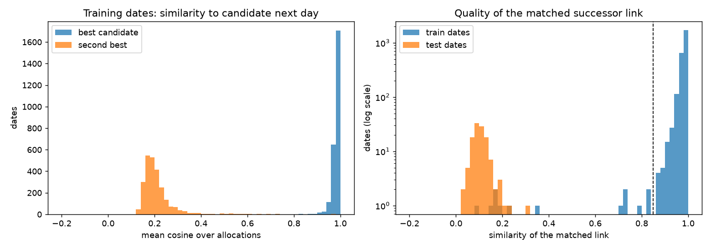
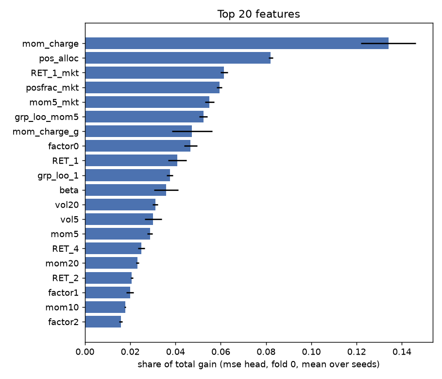

# qrt-allocation-returns

[](https://github.com/lucaspaulien/qrt-allocation-returns/actions/workflows/ci.yml)
[](LICENSE)

Predicting the **sign of the next-day return of 278 systematic allocations**
(QRT data challenge on [challengedata.ens.fr](https://challengedata.ens.fr)),
from each allocation's last 20 daily returns, signed volumes and turnover.
The score is plain accuracy of the predicted sign.

This is a low-signal problem: always predicting "up" already scores 0.5072,
and QRT's LightGBM benchmark scores 0.5079 on the public leaderboard. Most of
the work in this repo is therefore about **measuring correctly** rather than
about the model. Two findings drive everything else:

1. **The shuffled dates can be put back in order.** Date labels are
   anonymised and permuted, but the 20-day windows of two consecutive days
   overlap on 19 values. Matching every date to the date whose window is its
   own shifted by one day rebuilds the calendar of the 2,522 training dates
   almost perfectly (median similarity of the true successor 0.98, versus
   0.20 for the runner-up). That calendar is what makes an **honest,
   purged, chronological cross-validation** possible at all.
2. **Most of the signal is one-day momentum, and its strength differs by
   allocation in a persistent way.** `sign(RET_1)` alone scores 0.5189. The
   slope of tomorrow's return on today's ranges from -0.03 to +0.26 across
   allocations, and first-half vs second-half estimates of that slope
   correlate at 0.41, so it is worth learning per allocation -- with
   shrinkage, and refitted inside every fold because it uses the target.

## Headline result

Purged chronological 5-fold CV (blocks of consecutive days, 21-day embargo),
real data, `scripts/cross_validate.py` (raw numbers in `docs/cv_results.csv`;
the refactored package reproduces the original notebook to the fourth decimal
and the exact same submission file):

| Model | CV accuracy |
|---|---:|
| Always predict "up" | 0.5072 |
| `sign(RET_1)` | 0.5189 |
| Ridge (alpha = 1000) | 0.5253 |
| LightGBM, mse objective | 0.5249 |
| LightGBM, binary objective | 0.5270 |
| LightGBM, huber objective | **0.5277** |
| **Blend** (ridge + 3 heads, z-scored) | **0.5271** |

The blend scores between 0.5233 and 0.5325 depending on the fold (std
0.003), so differences below a point between rows are not meaningful; the
blend is submitted because it is the least dependent on any single
objective, not because it wins the table. For
scale: QRT's benchmark is 0.5079 on the public leaderboard, and the top of
the private leaderboard is 0.5504 with the pack between 0.526 and 0.532 (see
"Reading the two leaderboards" below for why the public one is not a target).

<p align="center">
  
</p>

*Left: for each training date, the similarity of the best candidate next day
vs the second best -- the true successor is never ambiguous. Right: the
matched link of every training date is strong; the 120 test dates have no
plausible neighbour at all (see below), so the test set cannot be chained.*

## The chronology, and why it does not leak into the test set

For an allocation observed on day `t` and on the next day `t'`:

```
RET_{i+1}(t') = RET_i(t)      for i = 1..19
RET_1(t')     = target(t)
```

The organisers added small noise to every value, so exact matching fails (a
naive check finds only 0.025% exact matches). Instead, `chronology.py`
normalises each (date, allocation) window to unit norm and averages the
cosine between `RET_1..RET_19` of date `i` and `RET_2..RET_20` of date `j`
over all allocations present on both. The resulting date x date similarity
matrix is solved as an assignment problem (Hungarian algorithm, one successor
per date), and links weaker than 0.85 cut the chain into **13 segments** of
truly consecutive days (largest: 622, 494, 362, 315, 260 and 157 days).

On the training set, the chain gives the target away: the target of `t` is
the (noisy) `RET_1` of its successor, `RET_2` of the next one, and so on.
Reading it from there scores **0.9245** accuracy. The obvious question is
whether the same works on the test set -- and it does not:

| Gap tested (days) | best test -> any | best any -> test | best train -> train |
|---:|---:|---:|---:|
| 1 | 0.405 | 0.417 | 0.999 |
| 3 | 0.422 | 0.411 | 0.999 |
| 8 | 0.470 | 0.438 | 0.997 |
| 12 | 0.451 | 0.462 | 0.995 |

No test date has any neighbour, in the test or the training set, within 12
trading days (beyond that, too few lags overlap for the cosine to
discriminate). The test block is isolated in time. A second check
independent of window alignment -- matching the cross-sectional signature of
every single real day contained in each row -- agrees: 3,640 of 4,000
signatures find a match inside the training set (median correlation 0.993),
versus 6 of 2,400 for the test set (median 0.56).

So the reconstruction is used **only to build the validation folds**.

## Validation: purged chronological folds

A random K-fold on the date labels -- what the benchmark does -- puts days
`t` and `t+1` on opposite sides of the split even though their windows share
19 values and the target of `t` *is* a feature of `t+1`. With the calendar
rebuilt, `validation.py`:

- splits each of the 13 segments into 5 contiguous blocks; block `k` of every
  segment forms fold `k`;
- drops from training every row within **21 days** (window + target) of a
  validation day of the same segment (segments are at an unknown distance
  from each other, so nothing is purged across them).

Each fold keeps ~96-109k validation rows, ~340-390k training rows, and purges
40-80k rows. This mirrors the test situation -- dates isolated from
everything the model was trained on. Measured on the same model and
features, a random K-fold reports 0.5217 against 0.5208 for the purged
version (`notebooks/qrt_solution.ipynb`): a real but small optimism bias of
0.0009, smaller than expected.

## Features and models

**Row features** (`features.py`, 28 columns, target-free so computed the same
way on train and test): `RET_1..RET_5`; 5/10/20-day momentum; 5/20-day vol and
vol-scaled momentum; share of positive days; lag-1 autocorrelation of the
window; signed volume from lag 2 (lag 1 is missing 74% of the time) and,
because missingness itself is informative, a flag for whether
`SIGNED_VOLUME_1` is present (P(up) moves from 0.5033 to 0.5179 when it is);
same-day cross-sectional ranks and means; beta to the day's average
allocation and the residual of `RET_1`; leave-one-out same-day mean of the
allocation's `GROUP`.

**Fold-refitted features** (`allocation.py`):
- *Per-allocation momentum loadings*: slope of target on `RET_1` and
  positive rate, per allocation and per group, each shrunk towards the global
  value with 800 pseudo-observations (anything from 200 to 10,000 gives
  0.5239-0.5241, so the constant barely matters), and their product with
  today's `RET_1`. Because they use the target, they are re-estimated on the
  training part of every fold, after purging.
- *Common factors*: PCA of the date x allocation matrix of `RET_1` (train and
  test dates together; no target involved), 6 factors; each allocation's
  loading times the day's score. +0.0016 on a single head (0.5236 -> 0.5252).

**Models** (`pipeline.py`): a ridge on standardised features, and LightGBM
with tight regularisation (depth 4, 16 leaves, >= 3,000 rows per leaf, L2 = 20,
feature and row subsampling) under three objectives -- `mse` on the raw
return, `huber` to cap the influence of extreme days, `binary` on the sign
the metric actually scores -- each averaged over three seeds. The submission
is the sign of the sum of the four z-scored predictions.

<p align="center">
  
</p>

The top feature is `mom_charge`, the allocation's shrunk momentum loading
times today's `RET_1`, followed by the allocation's own positive rate and the
day-level aggregates. Raw `RET_1` only ranks ninth because most of its
information is already carried, allocation by allocation, by `mom_charge`:
the model mostly exploits one-day momentum, scaled per allocation and
positioned within the day's cross-section.

## What was tried and dropped

All measured with the purged CV above.

- **Moving the decision threshold** (quantile 0.40 to 0.60 of the blend
  score): 0.5248-0.5275, no gain over the natural threshold at 0.
- **More features.** A 136-column version scores 0.5193 vs 0.5214 for a
  105-column one; the signal cannot support the dimension. Group aggregates
  at every lag, return-volume correlation and turnover interactions all
  degraded validation.
- **Target transforms** (winsorising, cross-sectional rank): 0.5230-0.5234
  vs 0.5231 for the raw target -- noise.
- **Momentum x turnover.** The intuition (high turnover = shorter horizon =
  reversal) does not show up: the RET_1/target correlation is flat across
  turnover quintiles (0.079 to 0.089, unordered).
- **Other leakage channels**: row-id order, exact train/test duplicates,
  decimal counts, allocations per date, column missingness. Nothing beyond
  noise, except the `SIGNED_VOLUME_1` presence flag, which is kept.

## Reading the two leaderboards

The public leaderboard tops out above 0.70; the private one at 0.5504. They
are the same participants -- some appear at ~0.67 public / 0.55 private, or
0.61 / 0.53. The public score is returned after every submission, submissions
are unlimited and the public subset is small, so flipping blocks of
predictions and watching the score eventually reveals the public labels. The
public scores form a continuum from 0.58 to 0.73 (a genuine leak would put
everyone at the same very high score), the climb is concentrated in a few
weeks, and the leak search above finds no shared real day between test and
anything else. None of that transfers to the private set, which is the
only target worth optimising.

## Correctness: how this is verified

`pytest -v` (all passing) runs on a synthetic panel generated exactly like
the challenge data -- 20-day windows over a latent return path, small noise,
missing rows, shuffled date labels, deliberate calendar breaks -- so the
ground truth is known:

- **`tests/test_chronology.py`** -- every true successor is recovered despite
  the noise and missing rows; the last day gets only a weak link; larger gaps
  find the right date; calendar breaks produce exactly the right number of
  segments, with rank differences equal to true day differences; the target
  is read back from successor windows.
- **`tests/test_validation.py`** -- folds are contiguous blocks inside every
  segment; the purge removes exactly the embargo zone, never validation rows,
  and nothing in other segments; several rows per date are handled.
- **`tests/test_features.py`** -- train/test column parity; cross-sectional
  ranks and means; the group mean really leaves the row out; **the loadings
  are unaffected by any change of the target outside the training mask** (the
  no-leakage property the CV relies on); shrinkage limits; orthonormal PCA
  loadings.
- **`tests/test_pipeline.py`** -- end-to-end reconstruct -> fold -> fit ->
  predict on a panel with real momentum: the blend and the ridge both beat
  the base rate by more than 5 points out of fold.

## Project layout

```
qrt-allocation-returns/
├── src/allocpred/
│   ├── data.py            # loading the four challenge files
│   ├── chronology.py      # window-overlap similarity, successor matching, segments
│   ├── validation.py      # chronological folds + embargo purge
│   ├── features.py        # 28 target-free row features
│   ├── allocation.py      # shrunk per-allocation loadings, PCA common factors
│   └── pipeline.py        # ridge + 3 LightGBM heads, CV loop, final refit
├── scripts/
│   ├── reconstruct_chronology.py   # diagnostics above + docs/chronology.png
│   ├── cross_validate.py           # headline table + docs/feature_importance.png
│   └── make_submission.py          # refit on all training rows, write submission.csv
├── notebooks/qrt_solution.ipynb    # original exploratory notebook (French), with outputs
├── tests/                          # synthetic-panel test suite
└── docs/                           # figures and CV results from the real-data runs
```

## Running it

The data (~300 MB) is not redistributed. Download it from the challenge page
and place `X_train.csv`, `y_train.csv`, `X_test.csv` and
`sample_submission.csv` in `data/` (or point `ALLOCPRED_DATA` / `--data-dir`
elsewhere).

```bash
python -m venv .venv && source .venv/bin/activate
pip install -e ".[dev]"
pytest -v                                         # no data needed

python scripts/reconstruct_chronology.py --plot docs/chronology.png      # ~10 s
python scripts/cross_validate.py --importance-plot docs/feature_importance.png  # ~3-4 min
python scripts/make_submission.py --out submission.csv                   # ~1 min
```

## Known limitations

1. **The margin is small and the test set is short.** 120 test dates, a
   blend that moves by a full point from one fold to another: a one-point difference between two models is not
   interpretable, and the leaderboard can move by that much on luck alone.
2. **The test block is isolated in time** and nothing says whether it comes
   before or after the training period. If one-day momentum is weaker there,
   every model here is weaker too; the CV cannot detect a regime change it
   never saw.
3. **Hyperparameters were set by hand**, from a modest number of CV runs, not
   by a systematic search -- deliberately, given how little signal there is
   to tune against.
4. **The calendar is only partially recovered**: 13 segments at unknown
   distance from each other. Rows in different segments are never purged
   against each other, which is right only if segments are far apart.

## References

- Lopez de Prado, M. (2018). *Advances in Financial Machine Learning*, ch. 7
  (purged K-fold cross-validation and embargo). Wiley.
- Kuhn, H. W. (1955). *The Hungarian method for the assignment problem*.
  Naval Research Logistics Quarterly, 2(1-2), 83-97.
- Moskowitz, T., Ooi, Y. H., & Pedersen, L. H. (2012). *Time series
  momentum*. Journal of Financial Economics, 104(2), 228-250.

## License

MIT. See `LICENSE`. The challenge data belongs to its organisers and is not
included.
